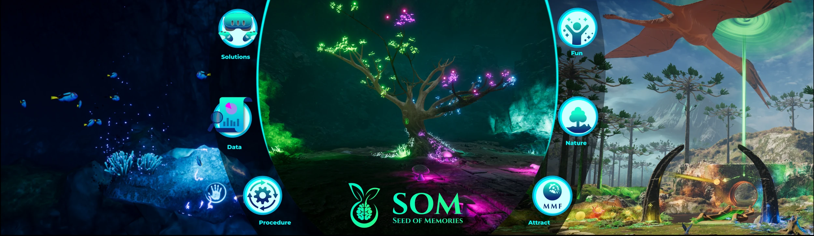
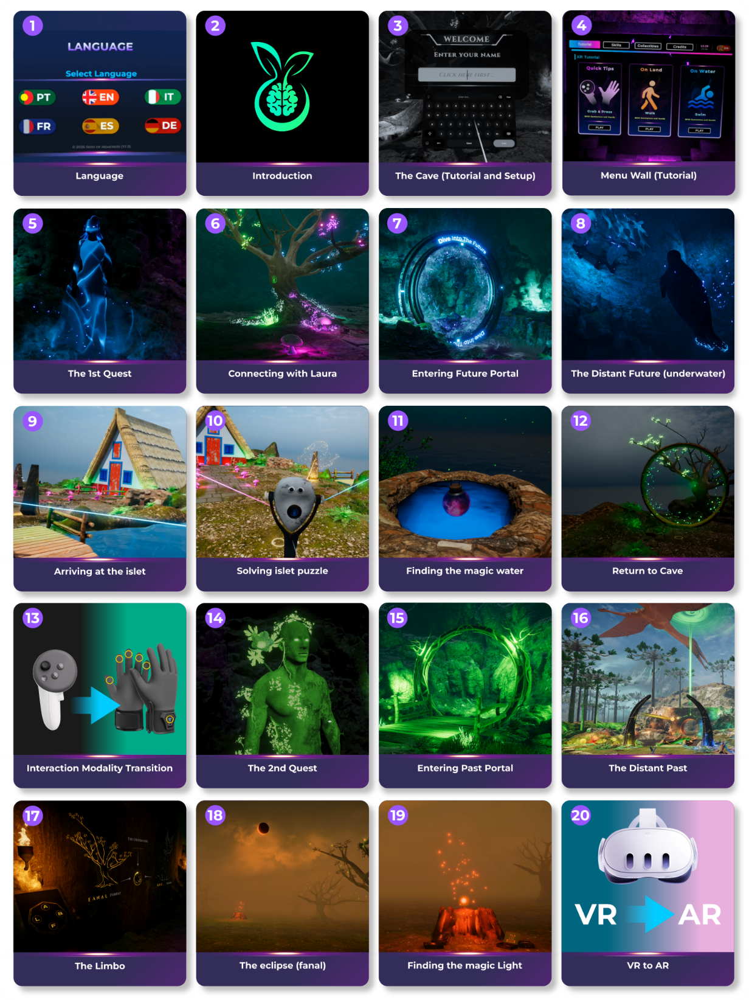
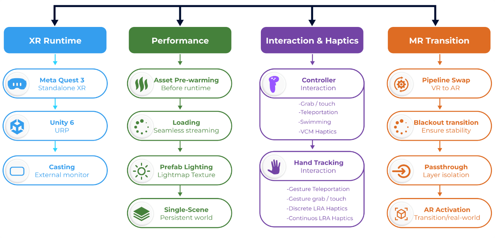
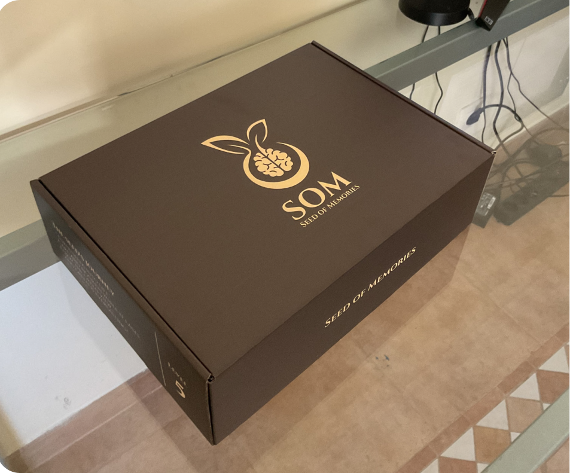
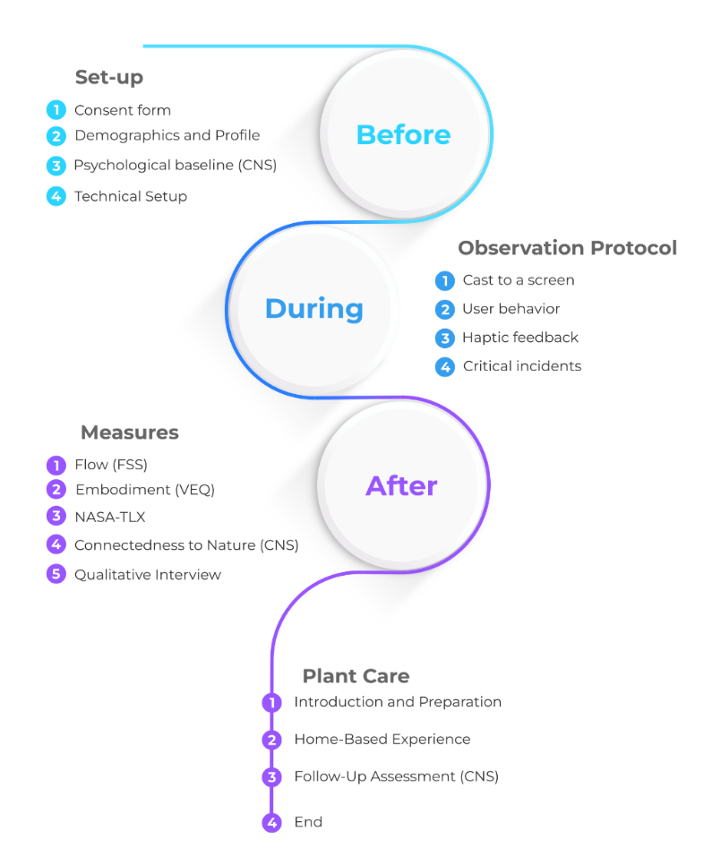

# Seed of Memories (SOM)

Seed of Memories is an XR exploration-based serious game that connects virtual interaction with real-world plant care. Built with Unity 6 URP for Meta Quest 3, it explores embodied interaction and connectedness to nature through a journey inspired by Madeira’s Laurisilva forest and its ecological and cultural heritage.

## The experience

Participants help restore Laura, the last laurel tree, by retrieving Magic Water from the Future and Magic Light from the Past. Underwater exploration, environmental puzzles and gesture-based interactions lead to a final passthrough sequence that connects the virtual quest with caring for a real plant.

Water and sunlight link the two parts of the experience: what participants seek in XR becomes what they provide through plant care.

View the XR experience sequence

## Interaction and study setup

- **Platform:** Meta Quest 3, running as a standalone application.
- **Development:** Unity 6 with the Universal Render Pipeline (URP).
- **Future scenario:** handheld controllers, teleportation and swimming interactions.
- **Past scenario:** hand tracking and gesture-based teleportation; bHaptics TactGlove supplies feedback in the experimental condition.

The experience can be played without haptic gloves. To reproduce the study’s hand-tracking-with-haptics condition, bHaptics TactGlove is required; playing without the gloves is not the same experimental condition.
- **Final transition:** VR to colour passthrough.

View the SOM XR apparatus

## Research context

The study investigates embodiment, flow, perceived workload and connectedness to nature. Participants experience both interaction modalities in a fixed narrative sequence, followed by questionnaires and an interview. The XR session lasts approximately 30 minutes.

## From XR to plant care

After completing the XR experience, each participant receives a **Seed of Memories Gift Box** containing a plant pot, soil, seeds, and planting and watering instructions. This begins the plant-care activity at home, supported by a reflective diary and a follow-up assessment over a period of up to two months.

View the Seed of Memories Gift Box

View the procedure from XR to plant care

## APK access

[**Download SOM for Meta Quest 3**](https://github.com/yanicklambert3d-cmyk/SOM-Seed-of-Memories/releases/download/v1.0/SOM-1.0-research-build-2026-10-25.7z) · [Release v1.0](https://github.com/yanicklambert3d-cmyk/SOM-Seed-of-Memories/releases/tag/v1.0)

The research APK is packaged in a password-protected .7z archive. Contact [lambertyanick@gmail.com](mailto:lambertyanick@gmail.com) to request access. See [installation instructions](INSTALLATION.md), [build information](BUILD-INFO.md) and [study reproduction notes](REPRODUCTION.md).

## Related links

- [Plant Growth Platform](https://som.yanicklambert.com)
- [Project portfolio](https://yanicklambert.com/UXResearch.html)
